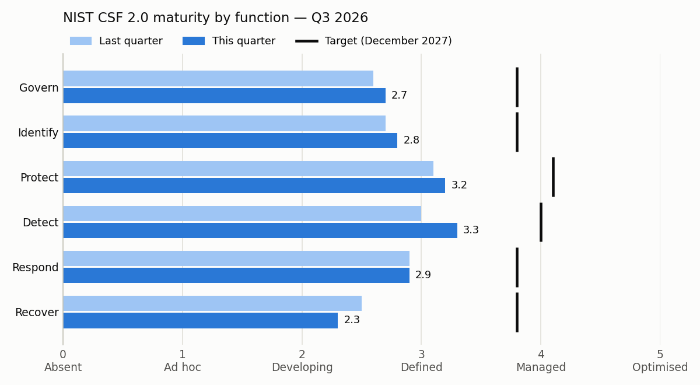

# Executive Risk Pack

[](LICENSE) [](https://github.com/bizidwassim-design/executive-risk-pack/actions/workflows/ci.yml) [](SECURITY.md)

A complete **quarterly cyber-risk pack for a board**, generated from a handful of CSV and YAML files: one-page
summary, NIST CSF 2.0 posture against target, top ten risks with a heat map, key risk indicators with RAG status,
a twelve-month regulatory and assurance calendar, and three decisions the board is asked to take. The sample is a
fictional Dubai payments company, **Fabrikam Payments LLC**, for Q3 2026. Swap the data and you have your own pack.

> 🇫🇷 Résumé en français en bas de page.

**Read the result first:** [`pack/board-pack.md`](pack/board-pack.md).



## Layout

```
data/                         The single source of truth (edit these)
  organisation.yaml           Profile, reporting dates, scales, bands, risk appetite, three-line narrative
  csf-profile.csv             22 NIST CSF 2.0 categories: current, target, last quarter (0-5) + evidence
  risks.csv                   Top 10 risks: inherent, residual, last-quarter scores, owner, treatment status
  kris.csv                    12 KRIs: direction, green and red thresholds, current and last-quarter values
  calendar.csv                12 months of PCI DSS, PDPL, UAE IA, ISO/IEC 27001, pen tests, tabletops
  decisions.yaml              3 board decisions: options, cost ranges, recommendation, risk if declined
scripts/
  packdata.py                 Loading, validation and every computation (scores, bands, RAG, trends)
  validate_data.py            Checks the data and reports every problem at once
  build_pack.py               Writes pack/: Markdown, workbook, charts
  roll_quarter.py             Copies "current" into "last quarter" to start the next pack
pack/                         Generated, committed, kept current by CI
  board-pack.md               The board pack (six sections + appendix)
  board-pack.xlsx             Same content, eight sheets, no macros
  charts/                     csf-current-vs-target.png · residual-risk-heatmap.png · chart-data.json
docs/
  method.md                   How every number is computed, with worked examples
  how-to-adapt.md             Replacing Fabrikam with your organisation, quarter by quarter
tests/                        pytest: scoring, validation, determinism, workbook, charts, roll-over
```

## Quick start

```bash
git clone https://github.com/bizidwassim-design/executive-risk-pack.git
cd executive-risk-pack
pip install -r requirements.txt          # openpyxl, PyYAML, matplotlib (pinned)
python scripts/validate_data.py
python scripts/build_pack.py
```

```
OK: 22 CSF categories in 6 functions, 10 risks (5 above appetite), 12 KRIs (4 green, 5 amber, 3 red), 14 calendar entries, 3 decisions
wrote pack/board-pack.md
wrote pack/board-pack.xlsx
wrote pack/charts/chart-data.json
wrote pack/charts/csf-current-vs-target.png
wrote pack/charts/residual-risk-heatmap.png
```

No matplotlib? The build still writes the Markdown, the workbook and `chart-data.json`, and warns that the PNGs were
not refreshed. Use `--no-charts` to skip them on purpose, and `--data` / `--out` to build another organisation's pack.

## What's inside

| Section of the pack | What the board sees | Computed from |
|---------------------|---------------------|---------------|
| **1. Summary** | Three-line message, a four-row "where we stand" table against last quarter, the decisions with their cost, what happens in the next 90 days | Everything below |
| **2. Posture vs target** | Six CSF 2.0 functions in plain words: last quarter, now, target, gap and status; bar chart; the four largest category gaps with the evidence | `csf-profile.csv` |
| **3. Top risks** | Ten risks ranked by residual score, inherent vs residual, appetite status, trend, treatment status; a 5×5 heat map as a Markdown table and as a PNG; what is being done about each risk above appetite | `risks.csv`, appetite in `organisation.yaml` |
| **4. KRIs** | Twelve indicators with 🔴🟠🟢 status, value now and last quarter, thresholds, trend and owner; why each red one matters | `kris.csv` |
| **5. Calendar** | Penetration tests, ASV scans, PCI DSS assessment, PDPL actions, UAE IA self-assessment, ISO/IEC 27001 surveillance audit, tabletops | `calendar.csv` |
| **6. Decisions** | Risk acceptance, budget and policy exception: context, options with cost range and effect on risk, recommendation, risk if declined, resolution to minute | `decisions.yaml` |
| **Workbook** | Summary, CSF Profile, Top Risks, Heat Map, KRIs, Calendar, Decisions, Scales — filters, frozen headers, RAG fills | Same data |

The validator refuses to build a pack when a likelihood or impact is outside 1–5, a maturity score outside 0–5,
a residual score above its inherent score, a risk or KRI without an owner, a KRI without both thresholds or with them
in the wrong order, a decision whose recommendation is not one of its options, an ID that links to nothing, a
calendar date outside the twelve-month window, or a calendar that forgets one of the required assurance events.
The rules and worked numbers are in [`docs/method.md`](docs/method.md).

## Design choices

* **Business impact first.** Every risk carries a one-sentence `business_impact` written for a director, and the
  impact scale is defined in money, hours of disruption and regulatory consequence, not in CVSS.
* **Appetite per category.** A payments company tolerates less uncertainty on card-scheme and data-protection
  obligations than on internal technology. One appetite figure per category makes that explicit.
* **Decisions, not just status.** The board's job is to decide. Every decision has options with a cost range,
  the effect on a named risk, a recommendation and what happens if the board declines.
* **KRI trends judged against the tolerance band.** A change counts only if it is at least 10% of the distance
  between the green and red thresholds, so noise is not reported as progress.
* **No hand-typed numbers.** The narrative is three sentences without figures; every number is computed. When the
  data changes, the pack cannot quietly disagree with it.
* **Reproducible to the byte.** Fixed timestamps in the workbook, LF line endings, pinned dependencies. CI rebuilds
  the pack and fails if the committed copy is stale, so Git history is an audit trail of what the board was told.
* **Markdown as the master copy.** It renders on GitHub, diffs cleanly, and converts to Word or PDF with any
  Markdown tool for the company template.

## Related repositories

| Repository | Relationship |
|------------|--------------|
| [application-risk-assessment-template](https://github.com/bizidwassim-design/application-risk-assessment-template) | Same 5×5 likelihood × impact bands; a project-level risk can be escalated into `risks.csv` unchanged |
| [grc-control-crosswalk](https://github.com/bizidwassim-design/grc-control-crosswalk) | Map the CSF 2.0 categories scored here to ISO/IEC 27001 Annex A, CIS v8 and SOC 2 |
| [ciso-executive-dashboard](https://github.com/bizidwassim-design/ciso-executive-dashboard) | The interactive companion: a single-page dashboard for the same audience between board meetings |
| [iso27001-iso42001-toolkit](https://github.com/bizidwassim-design/iso27001-iso42001-toolkit) | Risk-treatment plan, Statement of Applicability and policies (including the acceptable-use and AI policies behind decision D3) |
| [soc-detection-playbooks](https://github.com/bizidwassim-design/soc-detection-playbooks) | Detection and response content behind the Detect and Respond scores and the containment-time KRI |
| [public-scripts](https://github.com/bizidwassim-design/public-scripts) | Scripts that produce raw numbers for KRIs such as privileged-account inventory, devices without EDR and inactive or leaver accounts |

## Contributing

Better board wording, new validation rules, an HTML renderer and translations are welcome — see
[CONTRIBUTING.md](CONTRIBUTING.md) and the [Code of Conduct](CODE_OF_CONDUCT.md).

```bash
pip install -r requirements.txt pytest
pytest -q
```

## Disclaimer

A template and a worked example, not advice. Fabrikam Payments LLC, its risks, scores, costs, dates and people are
fictional; any resemblance to a real organisation is coincidental. Standards and regulations (NIST CSF 2.0,
PCI DSS v4.0.1, ISO/IEC 27001:2022, UAE PDPL, UAE Information Assurance Regulation) are referenced by name and
identifier only; check the current official texts and your own obligations before relying on any date or requirement.

## AI assistance

Built with Claude Code as a coding and writing assistant, which is why it appears as a co-author on some commits.
**Editor and reviewer: Wassim Bizid**, who set the scope, the frameworks and the GRC approach, edited the content
and decided what was published. Automated tests in CI check the published outputs. This is a maintainer review,
not an independent one.

## License

[MIT](LICENSE) — free to use, copy, modify and redistribute.

---

## 🇫🇷 Résumé

Modèle complet de **rapport trimestriel de risque cyber pour un conseil d'administration**, généré par un script
Python à partir de fichiers CSV et YAML : synthèse d'une page, maturité NIST CSF 2.0 actuelle et cible, dix risques
majeurs (inhérent, résiduel, tendance, appétence) avec carte de chaleur, indicateurs clés de risque avec statut
vert/orange/rouge, calendrier réglementaire sur douze mois (PCI DSS, PDPL, ISO/IEC 27001, tests d'intrusion,
exercices de crise) et trois décisions demandées au conseil avec options, coûts et recommandation. Produit un
fichier Markdown, un classeur Excel sans macro et deux graphiques, de façon reproductible et vérifiée par la CI.
Exemple fictif : « Fabrikam Payments LLC », Dubaï, T3 2026. Licence MIT.
