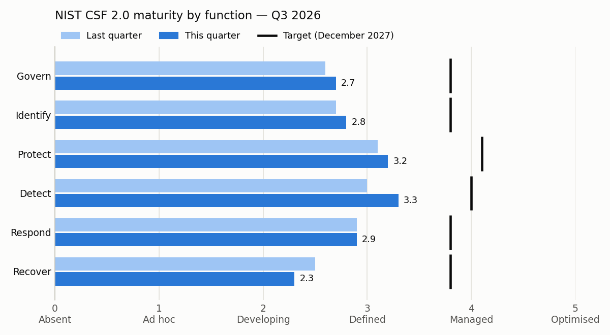

# Quarterly Cyber Risk Report to the Board — Q3 2026

**Fabrikam Payments LLC** · Board Risk Committee · 12 Nov 2026  
Prepared by the Chief Information Security Officer · Reporting period 1 Jul 2026 to 30 Sep 2026 · Board confidential (sample pack, fictional data)

> **Sample pack.** Fabrikam Payments LLC and every figure in this document are fictional. It is generated from the files in [`data/`](../data) by [`scripts/build_pack.py`](../scripts/build_pack.py).

## 1. Summary for the board

**Three things to remember**

1. Identity and detection controls improved this quarter, and fewer critical weaknesses are exposed to the internet.
2. Our ability to recover the payments platform after a major attack has weakened and is now our most urgent gap.
3. Supplier security reviews are behind schedule, so we are carrying more third-party risk than we accept.

**Where we stand**

| Measure | Last quarter | This quarter | Direction |
|---|---|---|---|
| Security maturity, 0–5 (target 3.9 by December 2027) | 2.8 | **2.9** (74% of target) | Improving |
| Top risks above the board's appetite | 6 of 10 | **5 of 10** | Improving |
| Key risk indicators at red | 4 of 12 | **3 of 12** | Improving |
| Top risks that moved | — | 5 better, 2 worse, 2 unchanged, 1 new | — |

**Decisions requested today**

| # | Decision | Type | Recommendation | Cost |
|---|---|---|---|---|
| D1 | Accept the risk from the old reconciliation server until 30 June 2027 | Risk acceptance | Option A: Accept with conditions until 30 June 2027 | AED 40k–60k |
| D2 | Fund a recovery environment for the payments platform in a second Azure region | Budget | Option A: Full programme in 2027 | AED 2.4m–2.9m |
| D3 | Allow a six-month governed pilot of an enterprise AI assistant | Policy exception | Option A: Time-boxed exception with guardrails | AED 150k–250k |

Approving all three recommendations commits AED 2.6m–3.2m. Details in section 6.

**Coming up in the next 90 days**

- 16–20 Nov 2026 — External penetration test of the payments API and merchant portal
- 7 Dec 2026 — Quarterly external vulnerability scan by an approved scanning vendor
- 10 Dec 2026 — Ransomware tabletop exercise with the executive committee
- 18–29 Jan 2027 — PDPL records of processing refresh and impact assessment for the new merchant app
- 8–26 Feb 2027 — PCI DSS annual assessment by a Qualified Security Assessor

## 2. Security posture against target

We score each of the 22 NIST CSF 2.0 categories from 0 (absent) to 5 (optimised) and average them by function. Overall maturity is **2.9 out of 5**, 74% of the target the board set for December 2027. The biggest improvement this quarter was in **Detect**. The largest gap to target is in **Recover**.

| Function | What it covers | Last quarter | Now | Target | Gap | Status | Trend |
|---|---|---|---|---|---|---|---|
| **Govern** | Direction, roles, policy and oversight of cyber risk | 2.6 | **2.7** | 3.8 | 1.1 | Priority gap | Improving |
| **Identify** | Knowing our assets, suppliers and risks | 2.7 | **2.8** | 3.8 | 1.0 | Gap | Improving |
| **Protect** | Safeguards that prevent or limit an attack | 3.1 | **3.2** | 4.1 | 0.9 | Gap | Improving |
| **Detect** | Spotting an attack quickly | 3.0 | **3.3** | 4.0 | 0.7 | Gap | Improving |
| **Respond** | Containing and managing an incident | 2.9 | **2.9** | 3.8 | 0.9 | Gap | Stable |
| **Recover** | Restoring service and trust after an incident | 2.5 | **2.3** | 3.8 | 1.5 | Priority gap | Worsening |

**Largest category gaps and why**

- **RC.RP Incident Recovery Plan Execution** — 2.0 against 4.0. Restore tests failed for 2 of 10 critical systems; no tested full rebuild of the payments platform.
- **GV.OV Oversight** — 2.0 against 3.5. The board receives a quarterly pack; outcomes of risk decisions are not yet tracked to closure.
- **GV.RM Risk Management Strategy** — 2.5 against 4.0. Board approved a risk appetite in March; risk tolerances are not yet set for every category.
- **GV.SC Cybersecurity Supply Chain Risk Management** — 2.0 against 3.5. Critical suppliers are tiered but six assessments are overdue; contract security clauses vary.

## 3. Top risks

These are the 10 risks that could hurt Fabrikam most. Each is scored from 1 to 25 (likelihood × impact) before controls (inherent) and with today's controls (residual). **5 risks are above the appetite the board approved.**

| # | Risk | Owner | Inherent | Residual | Appetite | Trend | Treatment |
|---|---|---|---|---|---|---|---|
| R03 | Security failure at a critical supplier | Chief Operating Officer | 16 High | 🟧 **16 High** | ≤ 9 — **above** | Worsening | At risk |
| R01 | Ransomware stops card processing | Chief Technology Officer | 20 Critical | 🟧 **12 High** | ≤ 8 — **above** | Improving | On track |
| R08 | Payments platform cannot be recovered in time | Chief Technology Officer | 15 High | 🟧 **12 High** | ≤ 8 — **above** | Worsening | Delayed |
| R02 | Card data stolen through the web or API channel | Head of Payments Engineering | 20 Critical | 🟧 **10 High** | ≤ 9 — **above** | Stable | On track |
| R10 | Confidential data leaked through public AI tools | Chief Data Officer | 12 High | 🟨 **9 Medium** | ≤ 9 — within | New | Not started |
| R04 | Takeover of a cloud administrator account | Head of IT Infrastructure | 20 Critical | 🟨 **8 Medium** | ≤ 9 — within | Improving | On track |
| R05 | Failed annual PCI DSS assessment | Chief Compliance Officer | 15 High | 🟨 **8 Medium** | ≤ 6 — **above** | Improving | On track |
| R07 | Insider misuse of customer or payment data | Chief People Officer | 12 High | 🟨 **8 Medium** | ≤ 9 — within | Stable | On track |
| R09 | Business email fraud diverts a payment | Chief Financial Officer | 16 High | 🟨 **6 Medium** | ≤ 9 — within | Improving | Complete |
| R06 | Breach of UAE data protection obligations | Data Protection Officer | 12 High | 🟨 **6 Medium** | ≤ 6 — within | Improving | On track |

**Residual-risk heat map** (where each risk sits today)

| Impact ↓ · Likelihood → | 1 Rare | 2 Unlikely | 3 Possible | 4 Likely | 5 Almost certain |
|---|---|---|---|---|---|
| **5 Severe** | 🟨 | 🟧 **R02** | 🟧 | 🟥 | 🟥 |
| **4 Major** | 🟩 | 🟨 **R04, R05, R07** | 🟧 **R01, R08** | 🟧 **R03** | 🟥 |
| **3 Significant** | 🟩 | 🟨 **R06, R09** | 🟨 **R10** | 🟧 | 🟧 |
| **2 Moderate** | 🟩 | 🟩 | 🟨 | 🟨 | 🟧 |
| **1 Minor** | 🟩 | 🟩 | 🟩 | 🟩 | 🟨 |

🟩 Low (1–4) · 🟨 Medium (5–9) · 🟧 High (10–16) · 🟥 Critical (17–25). The same map as a chart: [`charts/residual-risk-heatmap.png`](charts/residual-risk-heatmap.png).

**Risks that need the board's attention**

- **R03 Security failure at a critical supplier** (16, above appetite of 9). A breach or outage at our card processor, hosting partner or identity-check provider would stop onboarding or settlement and could expose customer data. *Next step:* Complete the six overdue critical-supplier assessments — at risk, due 31 Jan 2027.
- **R01 Ransomware stops card processing** (12, above appetite of 8). Merchants cannot take card payments. Each day offline costs an estimated AED 3m to 4m in lost fees and service-level penalties. *Next step:* Immutable backups in production for the payments platform — on track, due 15 Dec 2026.
- **R08 Payments platform cannot be recovered in time** (12, above appetite of 8). If recovery takes days rather than hours, we breach merchant contracts and the regulator may question our operational resilience. *Next step:* Second-region recovery environment (awaiting budget - decision D2) — delayed, due 31 Mar 2027.
- **R02 Card data stolen through the web or API channel** (10, above appetite of 9). A breach of cardholder data brings card-scheme fines, forensic costs and a possible loss of the right to process cards. *Next step:* Schema validation on every partner API endpoint — on track, due 31 Dec 2026.
- **R05 Failed annual PCI DSS assessment** (8, above appetite of 6). A failed Report on Compliance would put our acquiring relationships and card-scheme registration at risk. *Next step:* Close the four remaining gaps from the pre-assessment — on track, due 15 Jan 2027.
- **R10 Confidential data leaked through public AI tools** (new, 9, within appetite). Staff pasting customer data or source code into public AI services could breach data protection and card-data rules.

*Not yet measured:* R10 has no key risk indicator. One will be proposed in next quarter's pack.

## 4. Key risk indicators

12 indicators tell us early whether a risk is growing. This quarter: **4 green, 5 amber, 3 red.** Green means at or better than target; red means past the limit the board tolerates.

| Status | Indicator | Now | Last quarter | Green / red at | Trend | Owner |
|---|---|---|---|---|---|---|
| 🔴 Red | Critical suppliers with an overdue security review | **6** | 4 | ≤ 1 / > 4 | Worsening | Chief Operating Officer |
| 🔴 Red | Restore tests that succeeded for critical systems | **80%** | 92% | ≥ 95% / < 85% | Worsening | Chief Technology Officer |
| 🔴 Red | High-risk cloud misconfigurations open over 30 days | **12** | 15 | ≤ 3 / > 10 | Improving | Head of Cloud Platform |
| 🟠 Amber | Critical internet-facing weaknesses past their fix deadline | **5** | 9 | ≤ 2 / > 8 | Improving | Head of IT Infrastructure |
| 🟠 Amber | Privileged accounts without phishing-resistant MFA | **3** | 7 | ≤ 0 / > 5 | Improving | Head of IT Infrastructure |
| 🟠 Amber | Median time to contain a high-severity incident | **9.5** | 7.0 | ≤ 4.0 / > 24.0 | Worsening | Head of Security Operations |
| 🟠 Amber | Laptops and servers protected by endpoint detection | **96.4%** | 95.1% | ≥ 98.0% / < 92.0% | Improving | Head of IT Infrastructure |
| 🟠 Amber | Customer data requests answered late | **1** | 0 | ≤ 0 / > 2 | Worsening | Data Protection Officer |
| 🟢 Green | Phishing simulation click rate | **3.8%** | 5.2% | ≤ 4.0% / > 10.0% | Improving | Chief Information Security Officer |
| 🟢 Green | Card-data systems failing the hardening baseline | **1.8%** | 2.6% | ≤ 2.0% / > 8.0% | Improving | Head of Payments Engineering |
| 🟢 Green | Microsoft 365 and Azure secure configuration score | **81%** | 74% | ≥ 80% / < 65% | Improving | Head of IT Infrastructure |
| 🟢 Green | Leavers whose access stayed active over 24 hours | **0** | 5 | ≤ 0 / > 3 | Improving | Chief People Officer |

**Why the red indicators matter**

- **Critical suppliers with an overdue security review: 6.** Suppliers we depend on whose security we have not checked on schedule. Linked to R03.
- **Restore tests that succeeded for critical systems: 80%.** Share of critical systems we proved we can bring back from backup this quarter. Linked to R01, R08.
- **High-risk cloud misconfigurations open over 30 days: 12.** Serious cloud setting errors that have not been fixed within a month. Linked to R02, R04.

## 5. Regulatory and assurance calendar

The next twelve months of audits, assessments, tests and exercises (1 Oct 2026 to 30 Sep 2027).

| When | Activity | Why | Owner | Status | Note for the board |
|---|---|---|---|---|---|
| 16–20 Nov 2026 | External penetration test of the payments API and merchant portal | PCI DSS v4.0.1 requirement 11.4 | Head of Payments Engineering | Booked | Critical findings must be fixed before the PCI DSS assessor arrives in February. |
| 7 Dec 2026 | Quarterly external vulnerability scan by an approved scanning vendor | PCI DSS v4.0.1 requirement 11.3.2 | Head of IT Infrastructure | Booked | A passing scan is needed every quarter. |
| 10 Dec 2026 | Ransomware tabletop exercise with the executive committee | NIST CSF 2.0 RS.MA and RC.RP | Chief Information Security Officer | Planned | Board members are invited to observe the second half. |
| 18–29 Jan 2027 | PDPL records of processing refresh and impact assessment for the new merchant app | UAE PDPL (Federal Decree-Law No. 45 of 2021) | Data Protection Officer | In preparation | Closes the main open action under risk R06. |
| 8–26 Feb 2027 | PCI DSS annual assessment by a Qualified Security Assessor | PCI DSS v4.0.1 | Chief Compliance Officer | Booked | Report on Compliance due to our acquiring banks by 31 March 2027. |
| 8 Mar 2027 | Quarterly external vulnerability scan by an approved scanning vendor | PCI DSS v4.0.1 requirement 11.3.2 | Head of IT Infrastructure | Booked |  |
| 15 Apr 2027 | UAE Information Assurance Regulation annual self-assessment | UAE Information Assurance Regulation | Chief Information Security Officer | Planned | Results come to the board in the Q1 2027 pack. |
| 10–12 May 2027 | ISO/IEC 27001 surveillance audit by the certification body | ISO/IEC 27001:2022 | Chief Information Security Officer | Booked | Year two of the certification cycle. Two minor findings from 2026 are closed. |
| 7 Jun 2027 | Quarterly external vulnerability scan by an approved scanning vendor | PCI DSS v4.0.1 requirement 11.3.2 | Head of IT Infrastructure | Booked |  |
| 14–18 Jun 2027 | Full recovery test of the payments platform in a second Azure region | NIST CSF 2.0 RC.RP | Chief Technology Officer | Conditional | Only possible if the board approves decision D2. |
| 5–9 Jul 2027 | PDPL annual review of breach notification and customer request handling | UAE PDPL (Federal Decree-Law No. 45 of 2021) | Data Protection Officer | Planned |  |
| 16–27 Aug 2027 | Internal penetration test and segmentation test of the card-data environment | PCI DSS v4.0.1 requirement 11.4 | Head of Payments Engineering | Planned |  |
| 6 Sep 2027 | Quarterly external vulnerability scan by an approved scanning vendor | PCI DSS v4.0.1 requirement 11.3.2 | Head of IT Infrastructure | Planned |  |
| 20 Sep 2027 | Data breach tabletop exercise with the board | Board oversight of cyber risk | Chief Information Security Officer | Planned | Two hours. Board members play their own roles. |

## 6. Decisions required

### D1. Accept the risk from the old reconciliation server until 30 June 2027

*Risk acceptance · linked to R01 · decision needed by 12 Nov 2026*

One back-office server that reconciles daily settlement files runs an operating system that no longer receives security updates. It sits outside the card-data environment. Its replacement is part of the finance system upgrade that goes live in June 2027. Until then, a successful attack on this server could help ransomware spread to other systems.

| Option | What it means | Cost | Effect on risk |
|---|---|---|---|
| **A. Accept with conditions until 30 June 2027** (recommended) | Keep the server, isolate it on its own network segment, allow only two named connections, add extra monitoring, and take a daily offline copy of its data. | AED 40k–60k | Residual risk stays within appetite for this asset. Formal acceptance closes an audit observation. |
| B. Bring the replacement forward to March 2027 | Pay the finance-system vendor for extra people to finish the migration three months early. | AED 350k–450k | Removes the exposure three months sooner, but the extra cost is not in the 2026 or 2027 budget. |
| C. Switch the server off now | Reconcile settlement files by hand until June 2027. | AED 120k–180k | Removes the exposure today but adds manual work and a higher chance of settlement errors. |

**Recommendation: option A.** Option A cuts the realistic attack paths to almost none for a small cost. The three months gained by option B do not justify eight times the cost.

**If the board declines:** The server stays as it is without formal acceptance. The ISO/IEC 27001 auditor will raise it again in May 2027, and the ransomware risk (R01) keeps an easy entry point.

> **Proposed resolution.** The board accepts the residual risk from the reconciliation server until 30 June 2027, on the conditions in option A, and asks the CISO to confirm decommissioning in the Q2 2027 pack.

### D2. Fund a recovery environment for the payments platform in a second Azure region

*Budget · linked to R01, R08 · decision needed by 12 Nov 2026*

Today we could rebuild the payments platform after a destructive attack, but our best estimate is three to five days. Merchant contracts allow four hours. Restore tests failed for two of ten critical systems this quarter. This is the main reason risk R08 moved from Medium to High.

| Option | What it means | Cost | Effect on risk |
|---|---|---|---|
| **A. Full programme in 2027** (recommended) | Backups that cannot be changed or deleted, a standby environment in a second Azure region, and two full recovery tests a year. Target recovery time of four hours by the end of June 2027. | AED 2.4m–2.9m | R08 falls from 12 (High) to an expected 6 (Medium), inside appetite. R01 falls from 12 to an expected 8. |
| B. Backups only in 2027, standby region in 2028 | Buy the protected backups now and defer the second region by a year. | AED 1.3m–1.6m | Data is safe, but recovery still takes days. R08 falls to an expected 9, still above appetite. |
| C. Defer to the 2028 budget | No new spending. Keep improving restore tests within the current budget. | No new spend | R08 stays at 12 (High), outside appetite, for at least another year. |

**Recommendation: option A.** One day of lost processing costs about AED 3m to 4m. A single serious incident would cost more than the programme. Option A is the only option that brings recovery inside our contractual promise to merchants.

**If the board declines:** We keep a recovery time of days against a promise of hours. A serious ransomware event could breach merchant contracts, trigger penalties and invite questions from the regulator about our resilience.

> **Proposed resolution.** The board approves up to AED 2.9m in 2027 for the payments platform recovery programme (option A), with progress reported in each quarterly pack.

### D3. Allow a six-month governed pilot of an enterprise AI assistant

*Policy exception · linked to R10 · decision needed by 12 Nov 2026*

Our acceptable-use policy bans putting any confidential data into external AI services. Staff surveys and web-traffic data show the ban is widely ignored, mostly by analysts and developers. A ban that is not followed gives us the risk without any of the control.

| Option | What it means | Cost | Effect on risk |
|---|---|---|---|
| **A. Time-boxed exception with guardrails** (recommended) | Allow 80 named staff to use one enterprise AI service inside our Microsoft 365 tenant for six months. No cardholder data. Customer data only after a data protection impact assessment. Data loss prevention blocks every other AI website. | AED 150k–250k | R10 falls from 9 to an expected 6. We learn what a permanent policy should say. |
| B. Keep the ban and enforce it | Block all AI websites and treat breaches as disciplinary matters. | AED 30k–50k | Lower cost, but likely to push use onto personal phones where we see nothing. |
| C. Broad exception for all staff | Lift the ban for everyone without the impact assessment or blocking controls. | AED 100k–150k | Fast, but customer data would flow to AI services we have not assessed. R10 would likely rise. |

**Recommendation: option A.** Option A replaces hidden use with visible, controlled use and gives the board facts for a permanent policy in mid-2027.

**If the board declines:** Unapproved AI use continues out of sight. Customer data could leave the company without any record, which would be hard to defend to the data protection regulator.

> **Proposed resolution.** The board approves a six-month exception to the acceptable-use policy for a governed AI pilot on the conditions in option A, and asks for a permanent policy proposal by June 2027.

## Appendix: how to read this pack

| Score | Likelihood | Impact |
|---|---|---|
| 1 | Rare - less than once in ten years | Minor - loss below AED 0.5m, no customer impact, no regulatory interest |
| 2 | Unlikely - once in five to ten years | Moderate - loss AED 0.5m to 2m, or a few hours of degraded service |
| 3 | Possible - once in two to five years | Significant - loss AED 2m to 8m, or up to one day of payment disruption, or a regulator enquiry |
| 4 | Likely - about once a year | Major - loss AED 8m to 25m, or several days of disruption, or a formal regulatory finding |
| 5 | Almost certain - several times a year | Severe - loss above AED 25m, or a week of disruption, or a threat to our licence or card-scheme registration |

- **Risk score** = likelihood × impact, 1 to 25. Bands: Low 1–4, Medium 5–9, High 10–16, Critical 17–25.
- **Appetite** is the highest residual score the board accepts for each category: Cyber 9, Regulatory 6, Data protection 6, Third party 9, Resilience 8, People 9, Technology 9.
- **Maturity** 0–5: 0 Absent; 1 Ad hoc; 2 Developing; 3 Defined; 4 Managed; 5 Optimised.
- **Trends** compare with last quarter. A KRI change smaller than 10% of the gap between its green and red thresholds is shown as stable.
- Full method: [`docs/method.md`](../docs/method.md).
